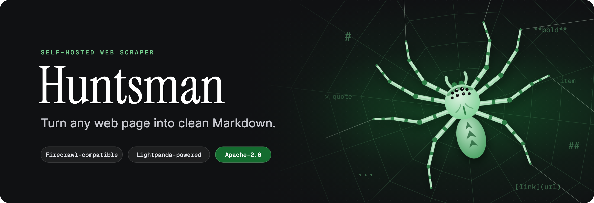

<p align="center">
  
</p>

<p align="center">
  <a href="https://github.com/TulipFarm/huntsman/actions/workflows/ci.yml"></a>
  <a href="https://github.com/TulipFarm/huntsman/releases"></a>
  <a href="https://github.com/TulipFarm/huntsman/pkgs/container/huntsman"></a>
  <a href="go.mod"></a>
  <a href="LICENSE"></a>
</p>

<p align="center">
  <a href="#quick-start">Quick start</a> ·
  <a href="#api">API</a> ·
  <a href="#benchmarks">Benchmarks</a> ·
  <a href="#configuration">Configuration</a> ·
  <a href="#development">Development</a>
</p>

Huntsman is a small, self-hosted web scraper that turns any page into clean Markdown for LLMs and search. It renders
JavaScript with [Lightpanda](https://github.com/lightpanda-io/browser), strips ads, trackers and cookie banners, and
serves a Firecrawl-compatible `/v1/scrape` API from one Go binary and one container. No Redis, no Playwright, no
Chrome.

## Why Huntsman

- **Fast and light.** On the same 8-vCPU machine it sustains 3.3× Firecrawl's throughput with half its memory.
- **Clean Markdown.** It keeps the main content and drops navigation, footers, ads and cookie banners, using
  Firecrawl's `onlyMainContent` rules and the EasyList filters.
- **Drop-in API.** Requests and responses follow Firecrawl's `/v1` shapes, so most clients only need a new base URL.
- **JavaScript when it matters.** Lightpanda renders single-page apps and waits until the page goes quiet. PDFs are
  fetched directly, and pages that block headless browsers are retried as plain HTML.
- **Batches and crawls.** A SQLite-backed queue handles up to 1,000 URLs per batch and whole-site crawls, with a
  per-host concurrency limit and a result cache.
- **Safe by default.** It blocks private, loopback and link-local addresses at dial time, obeys `robots.txt`, runs as a
  non-root user, and supports a bearer token.

## Quick start

Run the published image, for `linux/amd64` or `linux/arm64`:

```sh
docker run -d --name huntsman -p 127.0.0.1:8080:8080 -v huntsman-data:/data ghcr.io/tulipfarm/huntsman:latest
```

Scrape a page:

```sh
curl -s localhost:8080/v1/scrape \
  -H 'Content-Type: application/json' \
  -d '{"url": "https://example.com"}'
```

```json
{
  "success": true,
  "id": "d91d020c462b68ccb8126dee5a86cfad",
  "cached": false,
  "data": {
    "markdown": "This domain is for use in documentation examples without needing permission. …\n\n[Learn more](https://iana.org/help/example-domains)",
    "links": ["https://iana.org/help/example-domains"],
    "metadata": {
      "title": "Example Domain",
      "sourceURL": "https://example.com/",
      "statusCode": 200,
      "fetchedAt": "2026-10-27T06:10:48.552457254Z",
      "engine": "lightpanda"
    }
  }
}
```

In production, pin a version such as `ghcr.io/tulipfarm/huntsman:0.1.0`, or its digest, and set `HUNTSMAN_TOKEN`.

<details>
<summary>Build from source instead</summary>

```sh
git clone https://github.com/TulipFarm/huntsman.git && cd huntsman
docker compose up -d --build
```

</details>

## API

| Endpoint | What it does |
|---|---|
| `POST /v1/scrape` | Scrape one URL and return `markdown` and `links` |
| `POST /v1/batch` | Queue 1–1,000 URLs: `{"urls": [...], "scrapeOptions": {...}}` |
| `GET /v1/jobs/{id}` | Status and result of a queued job |
| `POST /v1/crawl` | Crawl a site: `{"url", "limit", "maxDepth", "scrapeOptions"}` |
| `GET /v1/crawl/{id}?offset=N` | Crawl progress and pages |
| `GET /health` | Liveness and storage check |

**Scrape options:** `url`, `formats` (only `markdown`), `waitFor` (ms), `waitSelector`, `timeout` (ms), `maxAge`
(ms, cache) and `onlyMainContent`. Unknown fields are rejected, so typos fail loudly instead of being ignored.

**Authentication:** if `HUNTSMAN_TOKEN` is set, every endpoint except `/health` needs
`Authorization: Bearer $HUNTSMAN_TOKEN`.

<details>
<summary>Crawl a site</summary>

```sh
curl -s localhost:8080/v1/crawl \
  -H 'Content-Type: application/json' \
  -d '{"url": "https://example.com", "limit": 50, "maxDepth": 2}'
# → {"success": true, "id": "…"}

curl -s 'localhost:8080/v1/crawl/<id>?offset=0'
```

</details>

### Coming from Firecrawl

Point your client at Huntsman's base URL and keep using `/v1/scrape`. Huntsman deliberately does less: it returns
Markdown and links only, with no screenshots, HTML, JSON extraction, actions or search. Pair it with a search engine
such as [SearXNG](https://github.com/searxng/searxng) if you need one.

## Benchmarks

1,000 URLs from Firecrawl's
[scrape-content-dataset-v1](https://huggingface.co/datasets/firecrawl/scrape-content-dataset-v1), on an AWS Graviton
`c7g.2xlarge` (8 vCPU), each engine self-hosted on the same machine:

| Engine | Max sustained concurrency | Pages / s | Content F1 | Peak memory (8 in flight) |
|---|---:|---:|---:|---:|
| **Huntsman** | **64** | **11.84** | **0.475** | **1.61 GB** |
| Firecrawl | 32 | 3.55 | 0.449 | 3.06 GB |
| Crawl4AI | 16 | 1.93 | 0.425 | — |
| Spider | 16 | 1.17 | 0.413 | — |

On 2 vCPU, Huntsman sustains 4.52 pages/s against Firecrawl's 1.23. Each figure is a single run against live sites,
with `robots.txt` checks off for every engine and Firecrawl in scrape-only mode. Methods, every machine size and the
raw numbers are in [benchmark/README.md](benchmark/README.md).

The repository also contains [huntsman-scrape-dataset-v1](dataset/huntsman-v1/README.md): 10,000 URLs balanced across
63 languages, script direction, rendering, page type, region and topic, with the pipeline that builds it.

## Configuration

All settings are environment variables.

| Variable | Default | Meaning |
|---|---|---|
| `HUNTSMAN_ADDR` | `127.0.0.1:8080` (`0.0.0.0:8080` in Docker) | Listen address |
| `HUNTSMAN_WORKERS` | `4` | Browser instances, i.e. pages rendered at once |
| `HUNTSMAN_PER_HOST` | `2` | Concurrent pages per host |
| `HUNTSMAN_QUEUE_CAPACITY` | `10000` | Queued jobs before `429` |
| `HUNTSMAN_CACHE_TTL` | `1h` | Default result cache age (max `168h`) |
| `HUNTSMAN_TOKEN` | empty | Bearer token; empty disables auth |
| `HUNTSMAN_OBEY_ROBOTS` | `true` | Respect `robots.txt` |
| `HUNTSMAN_ALLOW_PRIVATE` | `false` | Allow private and loopback addresses |
| `HUNTSMAN_IDLE_MS` | `200` | Network-idle wait before extracting |
| `HUNTSMAN_ADBLOCK_LISTS` | EasyList, EasyPrivacy, Fanboy Cookiemonster in Docker | Comma-separated filter list files |
| `HUNTSMAN_DB` | `data/huntsman.db` | SQLite queue and cache |
| `HUNTSMAN_BROWSER` | `lightpanda` | Browser binary |
| `HUNTSMAN_BROWSER_PORT` | `9222` | First CDP port; worker *i* uses port + *i* |

## Repository layout

```
src/         the scraper: cmd/huntsman (server) and internal/engine
benchmark/   speed, memory and accuracy against Firecrawl, Crawl4AI and Spider
dataset/     URL benchmark datasets and the scorer, eval.py
```

## Development

You need Go and, for browser tests, a Lightpanda binary.

```sh
go build ./...
go test ./...                                              # browser tests are skipped without a browser
HUNTSMAN_TEST_BROWSER=/path/to/lightpanda go test ./...
docker build --target test .                               # full test suite with Lightpanda inside Docker
```

### Releases

Maintainers release from their own machine; the build runs on GitHub Actions. You need the
[GitHub CLI](https://cli.github.com) and, for a preview of the version and notes, [git-cliff](https://git-cliff.org).

```sh
make release              # version from the commit messages: feat → minor (before 1.0), fix → patch
make release BUMP=minor   # or patch, major, or an exact version such as 1.0.0
```

The command checks that CI passed on `main`, shows the changes and next version, and asks before it starts the
[Release workflow](.github/workflows/release.yml). That workflow:

1. Writes [CHANGELOG.md](CHANGELOG.md) and commits it to `main`, then tags `vX.Y.Z`.
2. Runs the Docker test suite.
3. Publishes `ghcr.io/tulipfarm/huntsman` for `linux/amd64` and `linux/arm64`, tagged `X.Y.Z`, `X.Y` and `latest`,
   with a provenance attestation and an SBOM.
4. Pushes the commit and tag, and creates the GitHub release.

The script then watches the run until it finishes.

## Contributing

Issues and pull requests are welcome. Read [CONTRIBUTING.md](CONTRIBUTING.md) and the
[Code of Conduct](CODE_OF_CONDUCT.md) first. Please report vulnerabilities privately, as described in
[SECURITY.md](SECURITY.md).

## License

Huntsman is licensed under [Apache-2.0](LICENSE). The Docker image also ships third-party components under their own
licenses: the Lightpanda browser (AGPL-3.0, unmodified, run as a separate process) and the EasyList filter lists
(GPLv3 / CC BY-SA 3.0). The Firecrawl dataset is MIT and the Huntsman dataset is CC BY 4.0. See [NOTICE](NOTICE) for
details.

<p align="center"><sub>Built by <a href="https://tulipfarm.ai">TulipFarm</a>.</sub></p>
